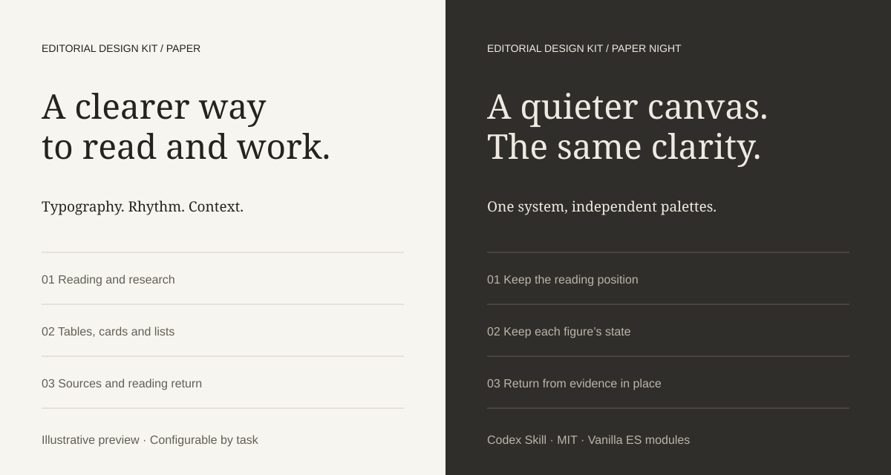

# Editorial Design Kit

[English](README.md) · **简体中文**

面向 Codex 的可配置编辑设计 Skill，附带可复用组件和可运行示例。用字体、留白与内容建立层级，在换色或核对来源时保持上下文。

受 Anthropic 编辑设计启发，属于独立项目，不是 Anthropic 官方组件库。



## 包含什么

- 自包含的 `editorial-design` Skill：设计原则、布局建议、交互契约与模板。
- 七套语义色卡，包含 Paper / Paper Night；支持完整自定义颜色 JSON，颜色与布局独立选择。
- 导航、表格、卡片、列表、阅读、媒体和来源核对的 Vanilla ES modules。可按现有 React/Vue 架构适配，不要求更换技术栈。
- 三份原创报告样稿及列表：摘要、章节导航、图表/数据独立切换、来源摘录与阅读回程。

Skill 用来指导 Codex，不会自动给应用添加前端依赖。示例使用原创建议和合成数据，不提供真实研究或 Agent 后端。

## 本地安装

需要 Codex；安装和本地服务需 Python 3.10+，可选测试需 Node.js 18+。无 npm 依赖，不需要 `npm install`。

克隆仓库（或解压下载包），从项目根目录运行：

```sh
git clone https://github.com/Rain1601/editorial-design-kit.git
cd editorial-design-kit
python3 scripts/install-local.py
```

默认安装至 `~/.agents/skills/editorial-design`。只供某个项目使用时：

```sh
python3 scripts/install-local.py --dest /path/to/project/.agents/skills
```

`--dest` 是父级 skills 目录。安装器复制完整 Skill、资源和 LICENSE；已有安装时拒绝覆盖，不修改 Codex 配置或外观。避免在多个发现目录重复安装同名 Skill。

Codex 自动发现新增 Skill；未出现时重启 Codex。更新前先备份并移走已有目录，再重新安装；不会静默合并文件。卸载时先保存本地修改，然后仅删除已安装的 `editorial-design` 目录。

### 从 GitHub 安装

在 Codex 中输入即可安装本仓库中的 Skill：

```text
使用 $skill-installer 安装：
https://github.com/Rain1601/editorial-design-kit/tree/main/skills/editorial-design
```

便携检查覆盖本地安装和示例依赖；远程验证结果记录在 VALIDATION.md。[Codex 官方 Skill 说明](https://learn.chatgpt.com/docs/build-skills)。

## 在 Codex 中使用

```text
使用 $editorial-design 优化现有研究报告。
保留真实内容和行为，采用 Paper / Paper Night。
换色时保留阅读位置、图表模式和来源面板状态。
```

```text
使用 $editorial-design 在当前 React 项目创建任务页。
采用自定义暖蓝灰、列表与详情栏布局。
保持自然简洁，复用当前应用架构。
```

颜色与布局分别选择，只复制所需模块及相对依赖。[Skill 入口](skills/editorial-design/SKILL.md)与内部详细规则目前以中文为主；双语 README 不表示内部文档已全部翻译。

## 运行示例

从项目根目录启动：

```sh
python3 -m http.server 8880 --bind 127.0.0.1
```

打开[示例入口](http://127.0.0.1:8880/)。端口被占用时换一个端口并调整地址。ES modules 需要 HTTP 服务，不能用 `file://` 打开。

| 示例 | 文件 |
|---|---|
| 报告列表与独立阅读记录 | [报告列表](examples/report-library.html) |
| Paper 报告 | [Paper](examples/research-report.html?report=evidence-to-judgment&palette=paper) |
| Paper Night 报告 | [Paper Night](examples/research-report.html?report=evidence-to-judgment&palette=paper-night) |
| 色卡、自定义 JSON、布局和基础组件 | [Starter](skills/editorial-design/assets/editorial/starter.html) |

交互预览请从 HTTP 示例入口进入；GitHub 文件页显示源码。示例使用系统字体，字形可能随系统变化。阅读元数据仅保留在当前标签页 sessionStorage；来源面板打开状态不跨导航恢复。报告契约目前限定 `authored-specimen`，生产报告需显式适配契约。

## 验证

```sh
python3 scripts/check-portability.py
node --test tests/*.test.mjs
```

便携检查核对本地运行/文档链接、隔离安装、文件一致性及覆盖拒绝。契约测试核对数值、身份、阅读状态和配色。实际结果和边界见 [VALIDATION.md](VALIDATION.md)，不代表任意报告质量或完整无障碍验收。

## 许可与状态

**Editorial Design Kit · 0.1.0 · MIT。** 见 [LICENSE](LICENSE) 和[授权说明](LICENSE.md)。可安装的 Skill 内也附带 LICENSE。未打包专有字体、远程视频或品牌素材。

源码通过 GitHub 分发，不是 npm 包。仓库名 `editorial-design-kit`，Codex 调用名保留 `$editorial-design`。版本记录见 [CHANGELOG.md](CHANGELOG.md)。
